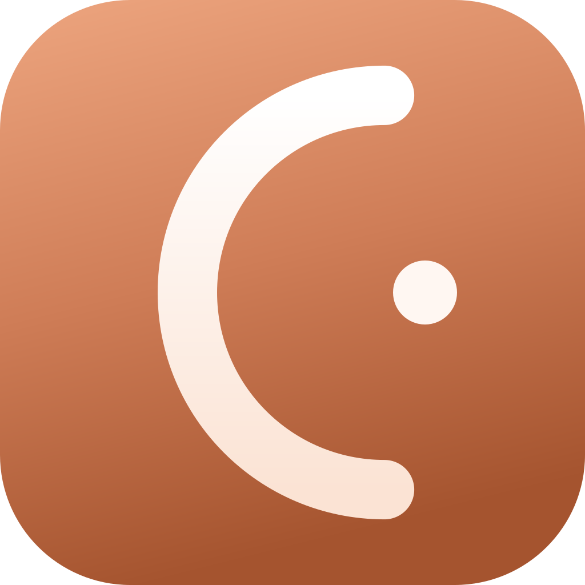

<div align="center">



# CaILens

**Record the hour, not the second.**

A local-first time tracker — not a calendar, not a to-do list, but a book you write one hour at a time.
No account, no server, no telemetry.

[中文](./README.md) · [Changelog](./CHANGELOG.md) · [Privacy](./PRIVACY.md)


</div>

<div align="center">

### Get started

```bash
npx cailens
```

One command runs the latest build (pulled from npm, no install, needs Node 20+).

[](https://github.com/vanemacus486-bit/CaILens/releases/latest)
[](https://github.com/vanemacus486-bit/CaILens)

</div>

> **Note:** the prebuilt exe lags behind the latest code. For the newest features use `npx cailens` or build from source.
> **Platforms:** only Windows desktop and the web are maintained. The mobile shell (Capacitor / Android) has been removed.

---

<!-- Screenshots pending: drop images into docs/screenshots/ and uncomment (that directory's png files are git-allowed).
<p align="center">
  
</p>
-->

## Why CaILens

Almost every calendar tool solves the same problem: *fitting the future into boxes* — reminding you of meetings, invites, alarms. But **understanding where your time actually goes** is a fundamentally different question.

Alexander Lyubishchev logged every hour of every day for 56 years, until his death. Not as a productivity performance, but as a tool for genuinely seeing how a life is spent. CaILens is an attempt at that tool for today.

- **Record, don't plan.** There is no schedule here. You log what already happened — not promises about tomorrow. See first, judge later.
- **Local-first.** All data lives in your device's IndexedDB. No account, no server, no network, no telemetry. Your time diary is yours alone.
- **Quiet by design.** Warm neutrals, serif headings, a restrained rust accent. The app never nags, rates, or interrupts — the only thing that keeps moving is the "now" line.
- **Code quality over feature count.** TypeScript strict mode, 1025 tests, one-way layered dependencies.

---

## Three domains

The app is organised into domains, and each domain is further split into plugins that can be toggled independently:

| Domain | Path | Contents |
|---|---|---|
| **Calendar** | `/week` | Owned by the shell. Week / day / month views — all logging and editing happens here |
| **Planning** | `/action` | Planning plugin. TODO states, priority, due-date grouping, plus projects and SOPs |
| **Review** | `/stats` | Review shell + five view plugins: trend / heatmap / sleep / diet / hygiene |

There is also a **Backfill** plugin at `/backfill` for bulk-entering past time blocks.

---

## Features

### Week view
- **24 hours × 7 days on one screen** — a week across, a day down, no scrolling.
- **Click empty space to create** — the event expands into an inline edit card; no modal, no focus stealing. Type the title, press Enter, and focus flows into the description.
- **Dragging is editing** — a hand-written continuous minute-axis on native Pointer Events; drag across midnight, grab an edge to resize.
- **Cross-midnight events** render as one continuous block; hover for a quick-read preview.
- **Week / month toggle** — `M` switches between the week grid and a month density overview.

### Quick log
- **Press `N` anywhere** (default `Ctrl+Alt+N`) for a minimal flow: name, category, note — Tab between fields, Enter to save.
- **Time auto-continues** from the end of your previous entry — no manual time setting.
- Autocomplete + recents, with an undo after saving.

### Day diary
- Serif headings and body paragraphs; descriptions render **Markdown** (bold / italic / lists / links).
- Subtle dividers appear where the activity type changes — logs read like a narrative, not a report.

### Review dashboard
The review domain is split into five independently toggleable views — turn any one off and the rest still work:

- **Trend** — multi-line charts at day / week / month granularity, overlaid with each category's weekly budget.
- **Heatmap** — a GitHub-style year heatmap, switchable by category, to see the rhythm of a whole year.
- **Sleep** — calendar-style Y axis at month / quarter / year scale, bedtime and wake scatter points, plus stability metrics (median, standard deviation, drift velocity).
- **Diet** — diet calendars, frequency matrices, and habit trends.
- **Hygiene** — the same for hygiene activities.

### Planning · Projects · Profile
- **Planning** — TODO states (to do / in progress / done) plus archiving, priority, and due-date grouping — clearly separated from *recording*.
- **Projects & SOPs** — events can belong to a project, forming an event → project → category model; each project can carry a versioned standard operating procedure.
- **Profile** — time series for height / weight / body fat / heart rate / blood pressure, set against your sleep baseline.

### Details
- **6 fixed categories** (primary focus / secondary focus / chores / self-improvement / rest & leisure / sleep), with editable names and weekly budgets.
- **2 visual styles** (`graphite` warm neutral / `tide` full-canvas dark) plus light / dark mode; event colors are WCAG AA contrast audited.
- **Global search** (`Ctrl+K`), **~30 customizable shortcuts**, **Chinese / English i18n**.
- **In-app auto-update** (Windows) — check, download, verify, install, and restart, all inside the settings page.

### Data freedom
- Export **CSV / JSON / encrypted `.cailens`** (age encryption + gzip); import CSV / JSON.
- **ICS import** — parses RFC 5545, grouping by event name and pre-filling categories.
- Everything stays local, portable, never locked in.

---

## Under the hood

> A **pure front-end, local-first, backend-free** app that still has to carry calendar interaction, a statistics engine, and desktop packaging. A few engineering decisions worth noting:

- **One-way layered architecture** — `use-cases → domain → data → stores → features`, reverse dependencies forbidden. `domain/` is side-effect free (no React, no IndexedDB), which is why 1025 unit tests can cover it completely.
- **A hand-written week view, no calendar library** — overlapping-event layout, drag-to-move and drag-to-resize are all self-implemented. The core is a **minute-axis coordinate system** (0..7×1440), which reduces cross-midnight dragging to simple arithmetic; the ghost layer drives the DOM directly via `requestAnimationFrame`.
- **Pure-function statistics engine** — week stats, time-of-day aggregation, sleep stability metrics (drift via linear regression), diet and hygiene frequencies, data-maturity scoring — all testable pure functions.
- **Plugin-based domains** — planning and review are not hard-coded pages but plugins. The review domain is a shell plus five view plugins, each toggled independently; the shell dispatches only by the `domain` / `domainViews` contract and never imports plugin internals.
- **One codebase, two targets** — the same React app ships a web bundle via Vite and a Windows exe via Tauri.
- **Engineering discipline** — TypeScript strict, `any` / `as unknown as` / `@ts-ignore` banned; components read data only through Zustand stores, never repositories directly.

### Stack

| Layer | Choice |
|---|---|
| UI | React 19 + TypeScript 6 (strict), Tailwind CSS v4, Radix UI |
| State / storage | Zustand v5 · Dexie v4 (IndexedDB), local-first, no backend |
| Routing / charts / dates | react-router-dom v7 (HashRouter) · Recharts 3 · date-fns v4 |
| Build / test | Vite 8 · Vitest 4 + Testing Library + fake-indexeddb (1025 tests / 80 files) |
| Desktop | Tauri v2 (Windows exe + in-app auto-update) |
| Crypto / fonts / icons | age-encryption · Inter / Source Serif 4 / JetBrains Mono / LXGW WenKai · lucide-react |

### Architecture

```
use-cases/  ──→  domain/  ──→  data/  ──→  stores/  ──→  features/ + components/ + pages/
(orchestration) (pure logic)  (Repo+Dexie)  (Zustand)      (UI)
```

`domain/` must not import React / Dexie / browser APIs. Data flows one way: components go through stores, stores wrap repositories, and repositories are the only place that touches IndexedDB.

---


## Roadmap

The core is largely done; what's next is expansion outward:

- [ ] **Deeper charts** — more correlation dimensions, customizable review views.
- [ ] **Third-party plugin channel** — plugins currently have to be compiled into the app (neither Tauri CSP nor a WebView allows loading remote code at runtime). The settings page already groups plugins into "core / third-party"; wiring up external plugins later only means filling in `origin` and `PLUGIN_GROUPS`.
- [ ] **End-to-end sync** — local-first sync between desktop and mobile (still no central server).
- [x] **Desktop only** — the mobile shell (Capacitor / Android) has been removed; only Windows desktop and web are maintained.
- [x] **In-app auto-update** — check, download, verify, install, restart.

Already-shipped milestones live in the [Changelog](./CHANGELOG.md).

---

## Running locally

Requires **Node 20+** and npm.

```bash
git clone https://github.com/vanemacus486-bit/CaILens.git
cd CaILens
npm install
npm run dev          # dev server (http://localhost:5173)
```

| Command | What it does |
|---|---|
| `npm run dev` | Dev server (hot reload) |
| `npm run build` | Typecheck + production build → `dist/` web bundle (**does not update the desktop exe**) |
| `npm run test` | Run unit tests once (1025) |
| `npm run lint` | ESLint |
| `npm run tauri:dev` | Desktop window + hot reload (use this while iterating) |
| `npm run tauri:build` | Rebuild the Windows desktop exe → `release/` |

> **`npm run build` is not "ship a new desktop build".** It only produces the web bundle. The desktop exe is a frozen snapshot of whatever `dist/` existed at the last `tauri:build` — rebuild with `tauri:build`, and close the running app first.

---

## Support the project

CaILens is free forever, local-first, with no ads or tracking. If it helped you see your time more clearly, you can buy the author a coffee — **Afdian** for China, **Gumroad** internationally:

<!-- TODO: replace these two placeholders with real sponsor pages (see src/lib/sponsor.ts) -->
[](https://afdian.com/a/REPLACE_ME)
[](https://REPLACE_ME.gumroad.com)

---

## License

[GNU AGPL-3.0](./LICENSE) — Copyright © 2025–2026 vanemacus486-bit.

Free to use, study, modify, and redistribute; but **any derivative work, or network service offered on top of this project, must release its complete source under AGPL-3.0**. To integrate it into a closed-source / commercial product, contact the author for a commercial license. See LICENSE for full terms.

<div align="center">
<sub>A book you write one hour at a time.</sub>
</div>
